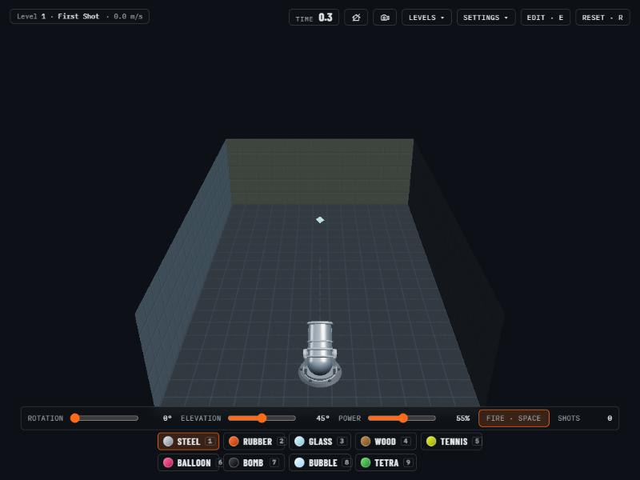

# Material Roll

A 3D physics puzzle game: aim a cannon (azimuth, elevation, power) and fire **one** ball at the goal inside a voxel room.
It is a single `index.html` built with [Three.js](https://threejs.org/) and the [Rapier](https://rapier.rs/) physics engine, and it includes a level editor.

## Play

**[Play the demo](https://mpragliola.github.io/material-roll-game/)**

It runs in any modern desktop or tablet browser. Three.js and Rapier are loaded from a CDN, so you need an internet connection.

## Features

- 18 large levels, each solvable with a single shot: bank shots, tunnels, portals, springs, fans, anti-gravity, lava, glass skylights.
- Nine balls with different physics. Switching ball mid-flight is allowed.
  - Steel, Rubber, Glass (breaks glass cubes), Wood, Tennis, Balloon (floats, then deflates), Bomb (splits in two on first contact), Soap bubble (no gravity, short life), Tetrahedron.
- Level editor with layer slicing on all three axes, undo/redo, ramps with corner pieces, an upside-down cannon, and level import/export as JSON.
- Touch controls for tablets, including a rotate tool, pinch to zoom and two-finger pan.
- Aids for big levels: ball silhouette behind walls, a cut-away along the line of sight, a roof toggle, and ripples where the ball touches the invisible room walls.

## Level format

Levels are plain data in the `LEVELS` array: `{ name, size: [X, Y, Z], hint, layers }`, where `layers` go from the floor up and each layer is a list of rows (z, north first) of X characters (x).
The editor's export button gives the same structure as JSON, and the import button loads it back.

## Deployment

Pushing to `main` runs `.github/workflows/deploy-pages.yml`, which copies `index.html` to the `gh-pages` branch with `keep_files: true`, so other content on that branch is not disturbed.
Pushing to `develop` publishes to `/unstable/`. The site is served at `https://mpragliola.github.io/material-roll-game/`.

## Run locally

Serve the folder with any static server, for example `python3 -m http.server`, and open `http://localhost:8000`.
